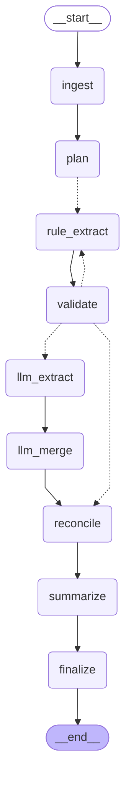

# Agent graph (generated by `python -m bid_intel graph`)

Solid edges always run; dotted edges are conditional (routing decided at run time). `rule_extract` and `llm_extract` run once per field group in parallel (LangGraph `Send`).

